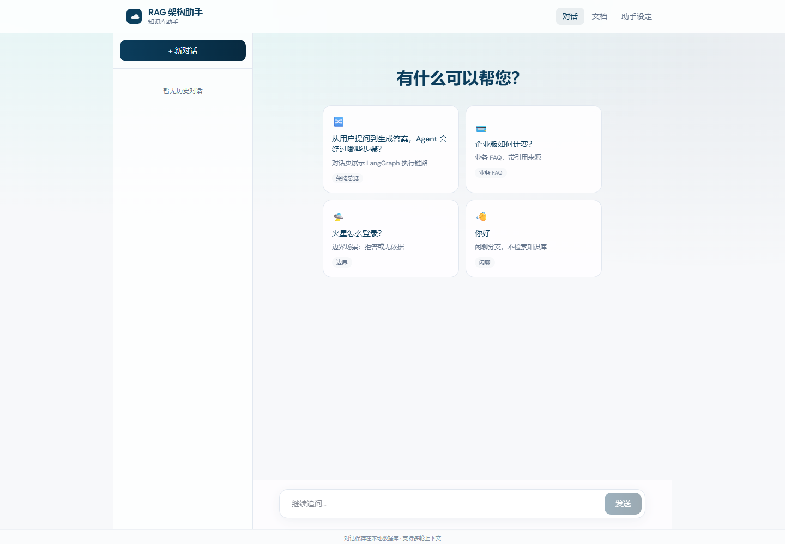
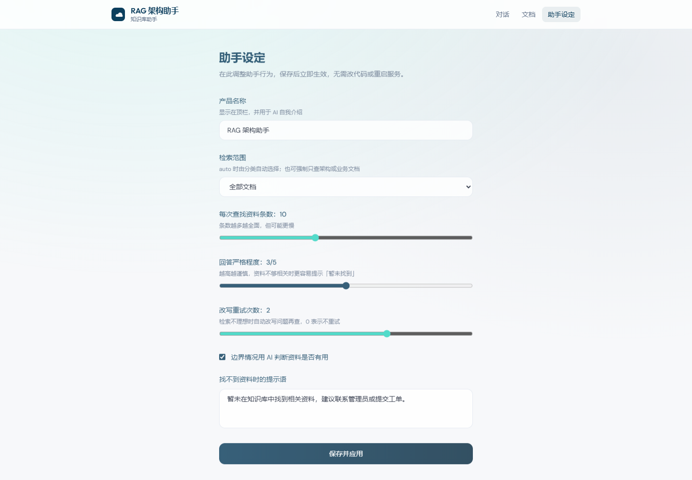

# RAG 架构助手

**回答技术问题，也把“答案怎么来”展示出来。**

RAG 架构助手是一套带执行链路展示的知识库问答应用。它以本项目的架构文档为主要知识源，使用 LangGraph 编排分类、检索、相关性判断、查询改写和回答生成，在前端呈现节点执行过程和引用信息。

项目将 React + TypeScript 界面、FastAPI API、混合检索、向量存储与会话记录组织为一套可本地运行的工程，适合观察 RAG 从问题输入到最终回答的完整过程。

## 界面预览

<p>
  
  
</p>

本地前端截图，使用默认设置与空会话列表；未执行真实检索或模型推理。

## 可以做什么

- **问项目架构**：例如有哪些 Agent 节点、何时触发 rewrite、Embedding 如何配置。
- **看执行过程**：通过 SSE 展示当前节点，历史回答可以打开执行详情。
- **追溯引用**：回答与知识片段关联，便于回到文档核对依据。
- **管理文档**：查看知识文档和分块信息，维护问答使用的内容。
- **调整范围**：区分架构语料与业务示例语料，按问题和配置控制检索范围。
- **评估检索**：使用固定问题与期望来源检查 Hit@k，而不是只凭回答观感判断效果。

## Agent 流程

```text
问题 → classify
          ├─ chitchat
          └─ retrieve → grade
                          ├─ generate
                          ├─ rewrite → retrieve
                          └─ refuse
```

分类节点判断是否需要知识库及语料范围；检索后判断片段是否足够相关。相关性不足时，可以在限制内改写查询重试，或选择拒答，避免所有输入都强行生成知识库答案。

## 检索与存储

- **向量检索**：Ollama `nomic-embed-text` 负责向量化，Chroma 保存向量索引。
- **BM25 检索**：补充对术语、名称与关键词的匹配。
- **融合与兜底**：通过 RRF 合并向量和 BM25 结果，并保留关键词子串补充逻辑。
- **分块**：较长内容按长度拆分并保留重叠，方便在局部上下文中检索。
- **记录**：SQLite 保存会话与 trace；知识文档与索引分开管理。

DeepSeek 用于分类、生成、改写及相关的模型推理，本地 Ollama 用于 Embedding。两者承担不同任务。

## 界面与技术栈

前端使用 React、TypeScript 与 Vite，包含对话、文档管理、助手设置和执行详情；后端使用 FastAPI、LangGraph、LangChain 与 SQLAlchemy，通过 REST 和 SSE 与界面连接。

主要知识库位于 `data/arch/`。`data/faq/`、`data/wiki/` 和 `data/product_manual/` 是用于检索演示的 NovaCloud 示例资料，不是该应用自身实现了文档协作、视频会议或计费产品。

## 快速开始

需要兼容项目依赖的 Python、Node.js/npm、Ollama，以及自己的 DeepSeek API Key。前端使用 Vite 8，Node.js 版本需满足该版本的引擎要求。

在项目根目录创建虚拟环境，并安装后端依赖：

```sh
python -m venv .venv
# 激活虚拟环境后
pip install -r backend/requirements.txt
```

将 `.env.example` 复制为 `.env`，填写自己的 `DEEPSEEK_API_KEY`。准备 Embedding 模型：

```sh
ollama pull nomic-embed-text
python -m backend.rag.ingest --source ./data
python -m uvicorn backend.main:app --reload --port 8000
```

另开终端启动前端：

```sh
cd frontend
npm ci
npm run dev
```

前端地址为 http://localhost:5173 ，API 文档位于 http://127.0.0.1:8000/docs 。后端与入库命令均从仓库根目录运行。

## 检查与评估

```sh
pytest backend/tests -q
python -m scripts.eval_retrieval
```

检索评估读取 `data/eval/golden_retrieval.jsonl`，需要先完成入库并启动 Ollama；检索层评估不调用 DeepSeek。修改分块或文档后，应重新建立索引再比较结果。

## 源码导航

```text
backend/agent/     图、状态、节点与流式执行
backend/api/       对话、文档和设置 API
backend/rag/       分块、入库与混合检索
backend/db/        会话与执行记录
backend/tests/     后端检查
frontend/src/      对话、文档与过程展示
data/arch/         本项目架构知识库
data/eval/         检索评估样例
scripts/           检索检查与评估入口
```

## 当前范围

仓库提供源码与示例文档，向量库、BM25 缓存、会话数据库和 API Key 均需在自己的环境建立。真实问答效果依赖模型、语料与配置；节点可观察不代表答案天然正确，仍应结合引用核对。

配置与更多开发步骤见 [本地开发说明](docs/LOCAL-DEVELOPMENT.md)。本次整理未调用真实付费模型或重建本机知识库。
