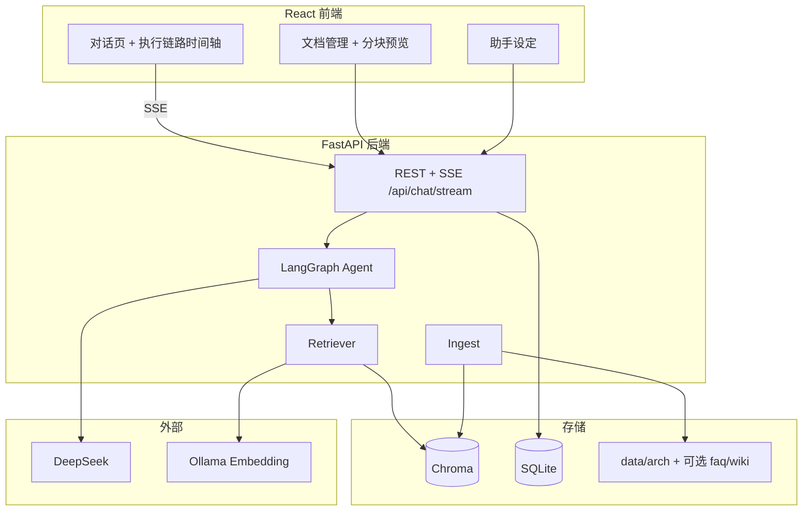

# RAG 架构助手

面向 **本仓库自身** 的技术问答应用：用 **LangGraph** 编排 Agent，用 **LangChain + Chroma** 做 RAG，用 **DeepSeek** 生成答案，前端通过 **SSE** 默认展示 LangGraph 节点执行过程。

核心知识库为自指文档目录 [`data/arch/`](data/arch/)（项目架构、节点流程、配置说明等），便于回答「有哪些节点」「rewrite 何时触发」等问题。

设计规格见 [`docs/superpowers/specs/2026-05-24-phase3-tech-visible-design.md`](docs/superpowers/specs/2026-05-24-phase3-tech-visible-design.md)。

---

## 架构概览



### Agent 流程

```
classify → retrieve → grade → generate | refuse
                    ↘ rewrite → retrieve（检索不理想时）
                ↘ chitchat（无需 RAG）
```

| 节点 | 作用 |
|------|------|
| `classify` | 判断是否查知识库，并输出 `corpus`（arch / business / all） |
| `retrieve` | 向量 + BM25（RRF）+ 关键词子串；可按 corpus 过滤 |
| `grade` | 判断片段是否足够相关 |
| `rewrite` | 改写 query 后重试检索 |
| `generate` | 带引用生成答案 |
| `refuse` / `chitchat` | 拒答或闲聊 |

### 模型分工

| 能力 | 实现 |
|------|------|
| 对话 / 分类 / 生成 / 改写 / 可选 grade | DeepSeek（`DEEPSEEK_API_KEY`） |
| Embedding | Ollama `nomic-embed-text` |
| 向量库 | Chroma（`data/chroma/`） |
| 会话与 trace | SQLite |

---

## 技术栈

| 层 | 技术 |
|----|------|
| 前端 | React 19、Vite、TypeScript、Tailwind |
| 后端 | FastAPI、LangGraph、LangChain |
| 向量库 | ChromaDB |
| LLM | DeepSeek |
| Embedding | Ollama |

---

## 环境准备

- Python 3.11+
- Node.js 18+
- Ollama 已运行：`ollama pull nomic-embed-text`
- [DeepSeek API Key](https://platform.deepseek.com)

---

## 快速启动

### 1. 依赖

```powershell
cd D:\RAG
python -m venv venv
venv\Scripts\activate
pip install -r backend\requirements.txt
```

### 2. 环境变量

```powershell
copy .env.example .env
```

编辑 `.env`，至少设置 `DEEPSEEK_API_KEY`。

### 3. 入库与后端

**必须在项目根目录启动：**

```powershell
python -m backend.rag.ingest --source ./data
uvicorn backend.main:app --reload --port 8000
```

入库会写入 Chroma 与 `data/bm25/index.pkl`（BM25 索引）。修改分块规则或文档后需 **全量 reindex**。

入库应包含 `data/arch/` 下 6 篇文档（总 chunk 数随内容而定）。

### 检索能力对比（Phase 3 → Phase 4）

| 版本 | 检索组成 |
|------|----------|
| Phase 3 | Chroma 向量 + 关键词子串合并 |
| Phase 4 | Chroma 向量 + BM25（RRF 合并）+ 关键词子串兜底；classify `corpus` + 设定页 `retrieval_scope` 过滤 |

长文档（单节 >400 字）会按 800 字切块、相邻块 overlap 100 字；reindex 后 chunk 数会增加。

### 4. 前端

```powershell
cd frontend
npm install
npm run dev
```

浏览器打开 http://localhost:5173

---

## 推荐验收问题

| 问题 | 预期 |
|------|------|
| **LangGraph 有哪些节点？** | 引用 `arch/langgraph-flow.md`；对话区可见节点时间轴 |
| **rewrite 何时会触发？** | 说明 grade 不通过且未超重试；可能出现 rewrite 节点 |
| **Embedding 用的是什么？** | 引用 `arch/config.md` 或 `arch/rag-pipeline.md` |
| **你好** | `chitchat`，无引用 |

历史回复可点「查看本次回答过程」打开详情抽屉。

---

## 项目结构

```
RAG/
├── backend/agent/     # LangGraph 图、节点、stream.py
├── backend/api/       # chat（含 SSE）、documents、settings
├── backend/rag/       # chunker、ingest、retriever
├── frontend/          # React
├── data/arch/         # 自指技术文档（主知识库）
├── data/faq|wiki|...  # 可选示例文档
└── docs/superpowers/  # 设计与进度
```

---

## 开发与测试

```powershell
pytest backend/tests -q
python -m backend.rag.ingest --source ./data
python -m scripts.eval_retrieval
```

`eval_retrieval` 对 `data/eval/golden_retrieval.jsonl` 做检索层 Hit@k 评测（需 Ollama + 已 ingest，不调用 DeepSeek）。

API 文档：http://127.0.0.1:8000/docs

---

## License

MIT
