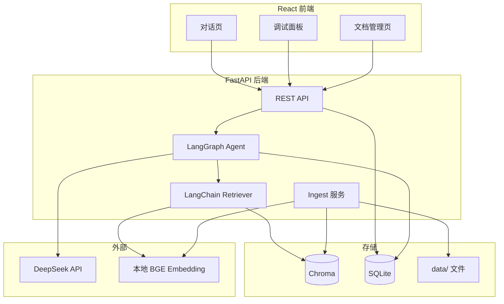
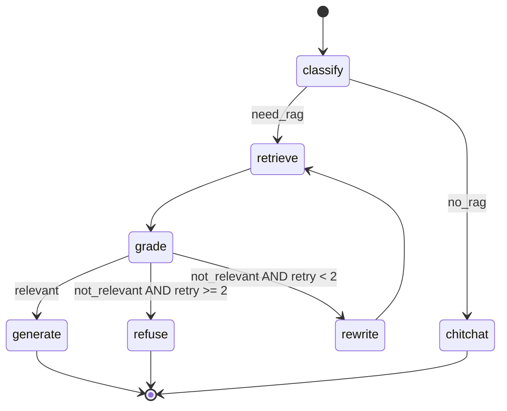

# NovaCloud 企业知识库 RAG Agent — 设计规格

> 状态：已批准  
> 日期：2026-05-24  
> 目标：求职作品集 — 可演示的全栈 Agent + RAG 案例

---

## 1. 背景与目标

### 1.1 问题

AI Agent 开发岗位普遍要求 RAG、LangChain、LangGraph 等能力，但缺少一个**可演示、可讲解、全链路可控**的案例项目。

### 1.2 目标

构建虚构 SaaS 公司 **NovaCloud 协作平台** 的企业知识库问答系统：

- **产品叙事**：企业内产品手册 / Wiki / FAQ 智能问答
- **技术叙事**：LangChain 负责 RAG 管道，LangGraph 负责 Agent 编排，DeepSeek 负责生成
- **作品集要求**：ReactDOM运行 Demo、架构清晰、前端可见调试信息、README 完整

### 1.3 非目标（YAGNI）

- 不集成 RAGFlow（网络环境限制，改为自研 ingest）
- 不引入 AutoGen 多 Agent 群聊（Phase 1 范围过大）
- 不做用户认证 / 多租户（演示项目不需要）
- 不做生产级高可用部署

### 1.4 约束

| 项 | 选择 |
|----|------|
| LLM | DeepSeek API（`deepseek-chat`） |
| Embedding | 本地 `BAAI/bge-small-zh-v1.5`（sentence-transformers） |
| 向量库 | Chroma（本地持久化目录） |
| 关系库 | SQLite（会话、消息、调试 trace） |
| Agent 框架 | LangGraph + LangChain |
| 后端 | FastAPI |
| 前端 | React |

---

## 2. 存储分工

三个存储各司其职，不可混淆：

```
┌─────────────────────────────────────────────────────────────┐
│  Chroma（向量库）                                            │
│  - 文档 chunk 向量 + 元数据（source, section, chunk_id）     │
│  - 仅 ingest 写入、retrieve 读取                             │
└─────────────────────────────────────────────────────────────┘

┌─────────────────────────────────────────────────────────────┐
│  SQLite（业务 + 调试持久化）                                  │
│  - sessions：会话列表                                        │
│  - messages：用户/助手消息                                    │
│  - traces：每次问答的 Agent 调试快照（JSON）                  │
│  - documents：已入库文档 registry（路径、状态、chunk 数）     │
└─────────────────────────────────────────────────────────────┘

┌─────────────────────────────────────────────────────────────┐
│  文件系统 data/                                              │
│  - 原始虚拟文档（Markdown / PDF）                             │
│  - Chroma persist 目录                                       │
│  - SQLite 文件 db/novacloud.db                               │
└─────────────────────────────────────────────────────────────┘
```

**说明**：SQLite 不替代向量库；Embedding 模型独立于 DeepSeek，负责检索阶段的语义匹配。

---

## 3. 系统架构



---

## 4. 后端模块结构

```
backend/
├── main.py              # FastAPI 入口、CORS、路由挂载
├── config.py            # 环境变量（DeepSeek Key、路径配置）
├── db/
│   ├── models.py        # SQLAlchemy 模型
│   └── session.py       # SQLite 连接
├── rag/
│   ├── ingest.py        # 文档解析、分块、写入 Chroma
│   ├── retriever.py     # VectorStore + top-k + 阈值
│   └── embeddings.py    # 本地 BGE 封装
├── agent/
│   ├── state.py         # AgentState TypedDict
│   ├── nodes.py         # 各图节点实现
│   ├── graph.py         # LangGraph 编译与 invoke
│   └── prompts.py       # Prompt 模板
├── api/
│   ├── chat.py          # POST /chat, GET /sessions
│   ├── debug.py         # GET /traces/{message_id}
│   └── documents.py     # GET/POST 文档、触发 re-index
└── schemas/             # Pydantic 请求/响应模型
```

### 4.1 代码规范（code-architect）

- 每个文件顶部 Docstring 说明模块职责
- 函数 Docstring 说明参数、返回值
- 卫语句提前返回，认知复杂度 ≤ 15
- API Key 仅通过 `.env` 加载，禁止硬编码
- 外部输入经 Pydantic 校验

---

## 5. LangGraph Agent 设计

### 5.1 状态图



### 5.2 AgentState 字段

| 字段 | 类型 | 说明 |
|------|------|------|
| `question` | str | 用户原始问题 |
| `rewritten_question` | str \| null | 改写后的检索 query |
| `route` | str | classify 结果：`need_rag` / `no_rag` |
| `documents` | list[Document] | 检索到的 chunks |
| `relevance_scores` | list[float] | 各 chunk 相似度分数 |
| `retry_count` | int | 改写重试次数 |
| `is_relevant` | bool | grade 结果 |
| `answer` | str | 最终回答 |
| `citations` | list[Citation] | 引用列表 |
| `node_trace` | list[NodeTrace] | 每节点耗时与输出摘要 |

### 5.3 节点说明

| 节点 | 调用 | 职责 |
|------|------|------|
| `classify` | DeepSeek | 判断是否需查 NovaCloud 知识库 |
| `retrieve` | LangChain Retriever | top-k 检索，记录 scores |
| `grade` | 阈值 + 可选 DeepSeek | 片段是否足以回答问题 |
| `rewrite` | DeepSeek | 改写 query 后重检 |
| `generate` | DeepSeek | 基于片段生成带引用答案 |
| `refuse` | 模板 | 拒答：库中无依据 |
| `chitchat` | DeepSeek | 简短寒暄，不捏造产品信息 |

### 5.4 Phase 划分

**Phase 1（MVP）**：classify → retrieve → generate / refuse（无 rewrite）  
**Phase 2**：加入 grade + rewrite 循环  
**Phase 3**：混合检索 BM25 + 向量（可选）

---

## 6. 调试信息 → 前端映射

每次问答完成后，后端将 `node_trace` 持久化到 SQLite `traces` 表，前端调试面板读取并可视化。

### 6.1 Trace 数据结构（JSON）

```json
{
  "message_id": "uuid",
  "question": "企业版如何计费？",
  "total_ms": 2340,
  "nodes": [
    {
      "name": "classify",
      "duration_ms": 320,
      "input": { "question": "企业版如何计费？" },
      "output": { "route": "need_rag" }
    },
    {
      "name": "retrieve",
      "duration_ms": 45,
      "input": { "query": "企业版如何计费？" },
      "output": {
        "top_k": 4,
        "chunks": [
          {
            "content": "...",
            "source": "wiki/billing.md",
            "section": "企业版定价",
            "score": 0.87
          }
        ]
      }
    },
    {
      "name": "generate",
      "duration_ms": 1800,
      "input": { "context_chunks": 3 },
      "output": { "answer_preview": "企业版按席位..." }
    }
  ],
  "citations": [
    { "source": "wiki/billing.md", "section": "企业版定价" }
  ]
}
```

### 6.2 前端调试面板 UI

| 区域 | 展示内容 |
|------|----------|
| **执行时间线** | 各节点顺序、耗时条形图 |
| **路由决策** | classify 结果及理由 |
| **检索详情** | query、top-k chunks、相似度分数、原文预览 |
| **改写历史** | rewrite 前后 query 对比（Phase 2） |
| **引用溯源** | 最终答案对应的 source / section 链接 |
| **原始 JSON** | 可折叠的完整 trace（开发者模式） |

---

## 7. API 设计

### 7.1 对话

| 方法 | 路径 | 说明 |
|------|------|------|
| POST | `/api/chat` | 发送消息，返回答案 + trace_id |
| GET | `/api/sessions` | 会话列表 |
| GET | `/api/sessions/{id}/messages` | 会话消息历史 |

**POST /api/chat 响应示例：**

```json
{
  "message_id": "uuid",
  "answer": "企业版按年订阅，每席位 99 元/月...",
  "citations": [{ "source": "wiki/billing.md", "section": "企业版定价" }],
  "trace_id": "uuid"
}
```

### 7.2 调试

| 方法 | 路径 | 说明 |
|------|------|------|
| GET | `/api/traces/{message_id}` | 完整调试 trace |

### 7.3 文档管理

| 方法 | 路径 | 说明 |
|------|------|------|
| GET | `/api/documents` | 已入库文档列表及状态 |
| POST | `/api/documents/reindex` | 触发全量或单文件 re-index |
| POST | `/api/documents/upload` | 上传新 Markdown（可选 Phase 2） |

---

## 8. 前端结构

```
frontend/
├── src/
│   ├── pages/
│   │   ├── ChatPage.tsx        # 主对话页（左聊天 + 右调试面板）
│   │   └── DocumentsPage.tsx   # 文档列表、re-index 按钮
│   ├── components/
│   │   ├── ChatWindow.tsx
│   │   ├── MessageBubble.tsx
│   │   ├── CitationBadge.tsx
│   │   ├── DebugPanel/
│   │   │   ├── TraceTimeline.tsx
│   │   │   ├── RetrieveDetails.tsx
│   │   │   └── RawJsonViewer.tsx
│   │   └── DocumentTable.tsx
│   ├── api/
│   │   └── client.ts           # axios/fetch 封装
│   └── App.tsx
```

### 8.1 页面布局（ChatPage）

```
┌──────────────────────────────────────────────────────────────┐
│  NovaCloud 知识库助手                              [文档管理] │
├─────────────────────────────┬────────────────────────────────┤
│                             │  🔧 调试面板                    │
│  对话区域                    │  ─────────────────────────────│
│  [示例问题快捷按钮]          │  ⏱ 时间线: classify→retrieve→gen│
│                             │  📊 检索: 4 chunks, scores...   │
│  User: 企业版如何计费？       │  📎 引用: billing.md § 企业版   │
│  Bot: ... [来源]            │  { raw JSON }                   │
│                             │                                │
├─────────────────────────────┴────────────────────────────────┤
│  [输入框]                                          [发送]     │
└──────────────────────────────────────────────────────────────┘
```

---

## 9. 虚拟演示数据

用户自行创建，建议结构：

```
data/
├── product_manual/
│   ├── overview.md          # 产品概述
│   ├── features.md          # 功能模块
│   └── integrations.md      # 第三方集成
├── wiki/
│   ├── deployment.md        # 部署指南
│   ├── permissions.md       # 权限模型
│   └── billing.md           # 计费说明
└── faq/
    ├── account.md           # 账号类 FAQ
    └── troubleshooting.md   # 故障排查 FAQ
```

**写作要点：**

- 内容虚构但内部自洽（价格、功能名统一）
- FAQ 采用「问：… / 答：…」格式，利于检索命中
- 故意留 2～3 个「库中不存在」的问题，用于演示拒答

---

## 10. 环境与运行

### 10.1 环境变量（`.env.example`）

```
DEEPSEEK_API_KEY=sk-xxx
DEEPSEEK_BASE_URL=https://api.deepseek.com
CHROMA_PERSIST_DIR=./data/chroma
SQLITE_URL=sqlite:///./db/novacloud.db
EMBEDDING_MODEL=BAAI/bge-small-zh-v1.5
```

### 10.2 启动流程

```bash
# 1. 安装依赖
pip install -r backend/requirements.txt
cd frontend && npm install

# 2. 入库虚拟文档
python -m backend.rag.ingest --source ./data

# 3. 启动后端
uvicorn backend.main:app --reload --port 8000

# 4. 启动前端
cd frontend && npm run dev
```

### 10.3 依赖清单（核心）

**Python：** fastapi, uvicorn, langchain, langgraph, langchain-community, chromadb, sentence-transformers, sqlalchemy, pydantic-settings, httpx

**Node：** react, vite, typescript, axios, tailwindcss（或 shadcn/ui）

---

## 11. 测试策略

| 层级 | 内容 |
|------|------|
| 单元 | retriever top-k、ingest 分块、grade 阈值 |
| 集成 | LangGraph 端到端（mock DeepSeek） |
| 手动 | 5 个预设问题 + 2 个拒答 case + 调试面板截图 |

不做过度测试；保证 README 中的 demo 脚本可复现。

---

## 12. 作品集交付清单

- [ ] GitHub 仓库 + README（架构图、技术选型理由、启动步骤）
- [ ] `.env.example` + 虚拟 data/ 样例
- [ ] 5+ 截图：对话、引用、调试面板、文档管理
- [ ] 可选：2 分钟录屏（展示检索 trace）
- [ ] 面试话术：DeepSeek vs BGE 分工、LangGraph 节点设计、为何不用 RAGFlow

---

## 13. 风险与缓解

| 风险 | 缓解 |
|------|------|
| Embedding 模型首次下载慢 | README 提供镜像说明 / 离线包路径 |
| DeepSeek API 限流 | 开发时 mock；演示前预跑通 |
| LangGraph 学习曲线 | Phase 1 先 3 节点，再扩展 |
| 范围膨胀 | 严格按 Phase 1→2→3，MVP 先可演示 |

---

## 14. 待确认项

- [x] 演示域：虚构企业 NovaCloud
- [x] LLM：DeepSeek API
- [x] Embedding：本地 BGE
- [x] 向量库：Chroma
- [x] 全栈：React + FastAPI + SQLite
- [x] 调试信息映射前端
- [x] 用户审阅本 spec 后进入 implementation plan
