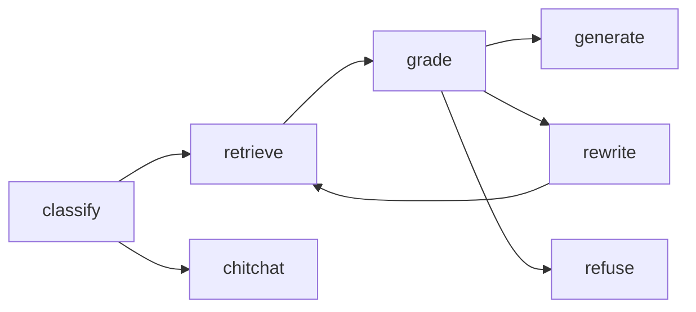

# Phase 2：Agent 改写循环 + 文档上传 — 设计规格

> 状态：已批准交付顺序（方案 A）  
> 日期：2026-05-24  
> 前置：Phase 1 MVP、UI 改版、会话历史、助手设定（runtime）已完成  

---

## 1. 目标

在不动 Phase 1 核心能力的前提下，分两批交付：

| 批次 | 内容 | 作品集价值 |
|------|------|------------|
| **2a** | grade + rewrite LangGraph 循环 | 展示 Agent 编排与可观测 trace |
| **2b** | Markdown 文档上传 + 增量入库 | 展示完整 RAG 数据面 |

**非目标（Phase 2）**：BM25 混合检索、PDF/Word、用户认证、替换 `data/` 内置演示文档正文。

---

## 2. 交付顺序（方案 A）

1. 实现 **2a** → 测试与 README 补充 → 可演示「改写重检」  
2. 实现 **2b** → 测试 → 可演示「上传即问」  

---

## 3. 批次 2a：grade + rewrite

### 3.1 状态图（替换当前 retrieve 后直连 generate/refuse）



- `classify` / `chitchat` 行为与 Phase 1 一致。  
- `retrieve` 使用 `rewritten_question or question` 作为 query。  
- **移除** `_route_after_retrieve` 中直接 `generate` 的分支；拒答改由 `grade` 在超重试时路由到 `refuse`。

### 3.2 AgentState 增补

| 字段 | 类型 | 说明 |
|------|------|------|
| `rewritten_question` | str \| null | 最近一次 rewrite 的检索 query |
| `retry_count` | int | 已 rewrite 次数，默认 0 |
| `is_relevant` | bool | grade 结果 |
| `grade_reason` | str \| null | 供 trace 展示：`distance` / `llm` / `empty` |

其余字段保持 Phase 1 定义。

### 3.3 grade 节点

**输入**：`question`、`chat_history`、`documents`（含 distance）

**逻辑（卫语句顺序）**：

1. `documents` 为空 → `is_relevant=false`，`grade_reason=empty`  
2. `min(distance) > max_retrieval_distance`（来自 `load_runtime()`）→ `is_relevant=false`，`grade_reason=distance`  
3. 若 `enable_llm_grade` 且距离落在边界带 `(threshold, threshold + grade_margin]` → 调用 DeepSeek 判定 JSON：`{"relevant": true/false}` → `grade_reason=llm`  
4. 否则 → `is_relevant=true`，`grade_reason=ok`  

**路由**（`_route_after_grade`）：

- `is_relevant` → `generate`  
- `not is_relevant` 且 `retry_count < max_rewrite_retries` → `rewrite`  
- `not is_relevant` 且 `retry_count >= max_rewrite_retries` → `refuse`  

### 3.4 rewrite 节点

- Prompt：结合 `question`、`chat_history`、上一轮 query、简短失败原因生成 **≤80 字** 检索向 query。  
- 更新：`rewritten_question`、`retry_count += 1`。  
- trace 记录：`original_query`、`rewritten_query`、`retry_count`。  
- 边：`rewrite` → `retrieve`（不回到 classify）。

### 3.5 运行时设定扩展（`backend/runtime.py`）

| 字段 | 默认 | 范围 |
|------|------|------|
| `max_rewrite_retries` | 2 | 0–3 |
| `enable_llm_grade` | true | bool |
| `grade_margin` | 80.0 | 0–200 |

写入 `data/runtime_settings.json`，助手设定页增加对应表单项（中文标签）。

### 3.6 API / 持久化

- `POST /api/chat` 响应结构不变。  
- trace JSON 的 `nodes` 增加 `grade`、`rewrite` 条目。  
- 无需新 DB 表。

### 3.7 前端

- **TraceDrawer**：步骤文案映射 `grade`→「判断资料是否有用」、`rewrite`→「改写问题再查」；若有 rewrite，展示原问 vs 改写 query。  
- **助手设定**：上述 3 项。  
- 不恢复常驻调试侧栏。

### 3.8 测试

- `backend/tests/test_graph_rewrite.py`：mock LLM，覆盖 rewrite 循环、超重试 refuse。  
- `backend/tests/test_grade_node.py`：距离拒答、边界 LLM（mock）。  
- 更新 `test_graph.py` 适配新路由。

### 3.9 演示用例

| 问题 | 预期 |
|------|------|
| 企业版贵不贵？ | 可能 1 次 rewrite 后命中 billing FAQ |
| 火星怎么登录？ | rewrite 后仍无依据 → 拒答 |
| 企业版如何计费？ | 通常 grade 通过，无 rewrite |

---

## 4. 批次 2b：文档上传

### 4.1 API

**POST `/api/documents/upload`**

- Content-Type：`multipart/form-data`，字段名 `file`  
- 仅允许 `.md`，单文件 ≤ 512 KB  
- 文件名消毒：去路径、仅保留 `[a-zA-Z0-9_\-\.]`，超长截断  

**响应**：

```json
{
  "status": "ok",
  "path": "data/uploads/xxx_title.md",
  "chunks_indexed": 12
}
```

### 4.2 存储与 ingest

- 保存目录：**`data/uploads/`**（不存在则创建）  
- 新增 `ingest_file(path: str) -> int`：只处理该文件，**不** `delete_collection` 全库；向 Chroma **追加** chunks，更新/插入 `DocumentRegistry`  
- 全量 `ingest_directory` / 前端「重新索引」行为不变（仍清库重建，文档中说明）  

### 4.3 安全

- 拒绝 `..`、绝对路径、非 `.md`  
- 不读取 `.env`；上传内容进入 Prompt 前仍经 chunk 截断  

### 4.4 前端（文档页）

- 拖拽区 + 选择文件  
- 上传中禁用按钮；成功显示 chunks 数并刷新列表  
- 错误：类型、大小、网络  

### 4.5 测试

- `test_upload_api.py`：合法 md、非法扩展名、路径穿越文件名  

---

## 5. 文件变更清单

### 2a

| 文件 | 变更 |
|------|------|
| `backend/agent/graph.py` | 新路由 grade/rewrite |
| `backend/agent/nodes.py` | grade_node、rewrite_node；retrieve 用 rewritten_question |
| `backend/agent/prompts.py` | GRADE_PROMPT、REWRITE_PROMPT |
| `backend/agent/state.py` | 新字段 |
| `backend/runtime.py` / `schemas/settings.py` | 3 项配置 |
| `frontend/.../SettingsPage.tsx` | 表单项 |
| `frontend/.../TraceDrawer.tsx` | rewrite 展示 |
| `frontend/src/lib/labels.ts` | 节点中文名 |

### 2b

| 文件 | 变更 |
|------|------|
| `backend/rag/ingest.py` | `ingest_file` |
| `backend/api/documents.py` | upload 路由 |
| `frontend/pages/DocumentsPage.tsx` | 上传 UI |
| `frontend/api/client.ts` | `uploadDocument` |

---

## 6. 验收清单

### 2a

- [x] 图：retrieve → grade → generate \| rewrite \| refuse  
- [x] trace 可见 grade/rewrite 与改写前后 query  
- [x] 助手设定可改重试次数  
- [x] pytest 新增用例通过  

### 2b

- [x] 上传 `.md` 后可被问答引用  
- [x] 非法文件被拒绝  
- [x] 文档列表显示新路径  

### 共通

- [ ] `pytest backend/tests -q` 全绿  
- [ ] `npm run build` 通过  
- [ ] README Phase 2 小节更新  

---

## 7. 与主 spec 关系

- 主 spec `2026-05-24-novacloud-rag-agent-design.md` §5.1 状态图以本文 2a 为准。  
- 产品对外名称以 runtime `product_name`（默认「云协通」）为准。  
