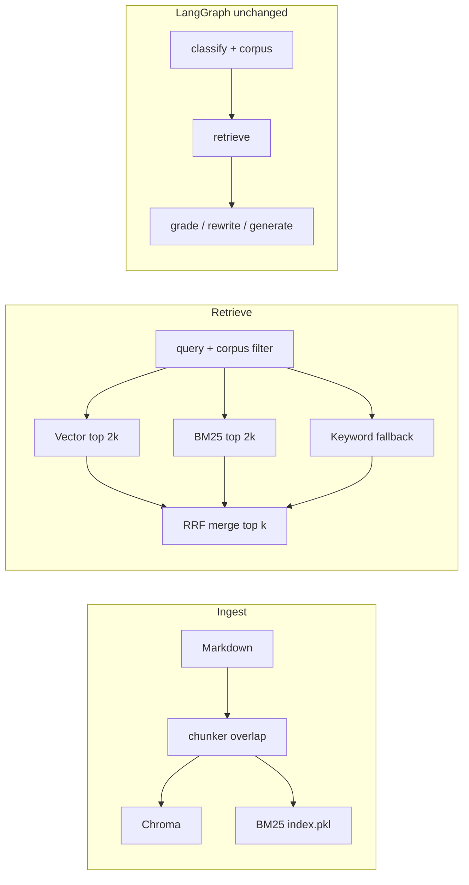

# RAG 增强包 — 设计规格

> 状态：已批准（2026-05-24）  
> 前置：Phase 3「RAG 架构助手」已落地  
> 目标：强化 RAG 工程可信度（切片 / 过滤 / BM25 / 评测 / Trace UI），**不**做企业级平台能力

---

## 1. 决策摘要

| 议题 | 决定 |
|------|------|
| critique / 双路检索 | **后续迭代**，本次不做 |
| 元数据过滤 | classify 自动 `corpus` + 助手设定 `retrieval_scope` 可覆盖 |
| 评测范围 | **仅检索层** Hit@k，不跑全 Agent |
| BM25 | ingest 持久化索引 + 与向量 **RRF** 合并，**保留**现有关键词子串兜底 |
| 定位 | 作品集 / 本地可运行，无认证、无高可用 |

---

## 2. 非目标

- 用户认证、多租户
- 高可用 / 分布式部署
- LangGraph `critique` 节点、arch/business 双路并行检索
- Agent 端到端评测（依赖 DeepSeek、结果波动）
- 「企业级平台」「大幅提升准确率」等无评测支撑的表述

---

## 3. 重叠切片

### 3.1 规则

- 模块：`backend/rag/chunker.py`
- 对 `##` 节正文 **长度 > 400 字** 时，按最大块长 **800 字** 切分，相邻块 **overlap 100 字**
- FAQ「问/答」整块、短节（≤400 字）不二次切分、不 overlap
- 常量写在 `chunker.py` 顶部，**不**暴露到助手设定页

### 3.2 迁移

- 修改后必须 **全量 reindex**：`python -m backend.rag.ingest --source ./data`
- `GET /api/documents/chunks` 与 ingest 共用 `split_markdown`，预览与入库一致

### 3.3 测试

- `test_chunker.py`：长段落产生多块且相邻块有重叠内容

---

## 4. 元数据过滤

### 4.1 classify 输出

扩展为 JSON（仅 `need_rag` 时需要 `corpus`）：

```json
{"route": "need_rag", "corpus": "arch"}
```

| `corpus` | 含义 | Chroma `where` |
|----------|------|----------------|
| `arch` | 架构 / 自指文档 | `source` 以 `arch/` 开头 |
| `business` | 业务示例文档 | `source` 前缀 ∈ `faq/`, `wiki/`, `product_manual/`, `uploads/` |
| `all` | 不限定 | 无 `where` |

`no_rag` 时仅需 `{"route": "no_rag"}`，忽略 `corpus`。

### 4.2 运行时覆盖

`RuntimeSettings` 新增字段：

| 字段 | 类型 | 默认 | 说明 |
|------|------|------|------|
| `retrieval_scope` | enum | `auto` | `auto` \| `all` \| `arch_only` \| `business_only` |

- `auto`：使用 classify 的 `corpus`
- 其余：强制对应 filter，忽略 classify 的 `corpus`

前端「助手设定」页增加下拉或单选；API `GET/PATCH /api/settings` 同步。

### 4.3 数据流

1. `classify_node` 解析 `route` + `corpus`，写入 `AgentState`
2. `retrieve_node` 根据 `retrieval_scope` 与 state 计算最终 filter
3. `retrieve_with_scores(query, top_k, corpus=...)` 传给 Chroma `where` 与 BM25 子集筛选
4. `node_trace` / SSE / `LiveRunTimeline` 展示中文：「检索范围：架构文档」等

### 4.4 测试

- 单元测试：filter 构建函数（各 corpus → where 子句）
- classify JSON 解析容错（缺 `corpus` 时默认 `all`）

---

## 5. BM25 混合检索

### 5.1 方案

采用 **ingest 时构建持久化 BM25 索引**（`rank-bm25`），检索时：

1. **向量** top `2k`（k = `retrieve_top_k`，带 metadata filter）
2. **BM25** top `2k`（在同一 filter 下的语料子集）
3. **关键词子串**（现有 `_keyword_search`，保留作中文 FAQ 兜底）
4. **RRF**（`k=60`）合并去重，取最终 `top_k`

### 5.2 持久化

- 路径：`data/bm25/index.pkl`（或 `corpus.pkl` + `bm25.pkl`）
- 内容：与 Chroma 一致的 chunk 列表（`text`, `source`, `section`, `doc_id`）
- **ingest / reindex** 结束时重建；**单文件 upload** 增量后更新该文件
- 依赖：`rank-bm25` 写入 `backend/requirements.txt`

### 5.3 返回结构

检索结果 dict 增加可选字段（评测与调试用，前端默认不展示）：

```python
{"content", "source", "section", "distance", "score", "channel": "vector" | "bm25" | "keyword"}
```

### 5.4 与旧行为差异（README 必写）

| 版本 | 检索组成 |
|------|----------|
| Phase 3 | Chroma 向量 + 关键词子串合并 |
| Phase 4 | Chroma 向量 + BM25（RRF）+ 关键词子串兜底 |

### 5.5 测试

- mock BM25 语料，验证 RRF 合并顺序与去重
- filter + BM25 子集：仅 `arch/` 文档进入候选

---

## 6. 检索层评测

### 6.1 数据

- 文件：`data/eval/golden_retrieval.jsonl`
- 条数：**10～20**
- 每行 JSON 字段：

| 字段 | 必填 | 说明 |
|------|------|------|
| `question` | 是 | 用户问句 |
| `expected_sources` | 是 | 期望命中的 `source` 前缀列表，任一命中即算对 |
| `corpus` | 否 | 传给 retriever 的 filter，默认 `all` |
| `note` | 否 | 人工备注 |

覆盖：`arch` 架构题、`faq/wiki` 业务题、需 filter 的题各若干。

### 6.2 脚本

- 入口：`python -m scripts.eval_retrieval`（项目根执行）
- 指标：**Hit@k**（`k = retrieve_top_k`）；可选打印 **MRR**
- 输出：每题命中与否 + 汇总命中率；未达标时 **exit code 1**（阈值可在脚本内配置，如 ≥ 80%）
- 依赖：已 ingest、Ollama 可用、BM25 索引存在；**不**调用 DeepSeek

### 6.3 pytest

- 2～3 条黄金题可做 integration 标记；或纯 mock retriever 返回值测 Hit 逻辑

---

## 7. Trace 改写对比 UI

### 7.1 TraceDrawer

- 存在 `rewrite` 节点时，列表上方固定 **「查询改写对比」** 卡片
- 左右或上下对照：**原 query**（`input.last_query` 或用户 `question`） vs **改写后**（`output.rewritten_query`）
- 标注第几次改写（`retry_count`）

### 7.2 LiveRunTimeline

- `rewrite` 节点 `detail` 文案与抽屉一致，避免两处信息不一致

### 7.3 API

- 不新增字段；沿用现有 trace `input` / `output`

---

## 8. 架构示意



---

## 9. 实现批次

| 批次 | 交付物 |
|------|--------|
| **4a** | overlap chunker + 测试 + README reindex 说明 |
| **4b** | `corpus` classify + `retrieval_scope` runtime/API/UI + retriever `where` |
| **4c** | BM25 ingest + RRF retrieve + `rank-bm25` + README 检索对比表 |
| **4d** | `golden_retrieval.jsonl` + `scripts.eval_retrieval` |
| **4e** | TraceDrawer / LiveRunTimeline 改写对比 |

---

## 10. 后续迭代（不在本次）

- **critique** 节点：生成前后 LLM 自检是否被资料支撑
- **双路检索**：arch 与 business 并行检索再融合（与当前「单路 + filter」不同）

---

## 11. 验收清单

- [ ] 全量 reindex 后长文档 chunk 数增加且 overlap 可测
- [ ] 问架构题时默认只检 `arch/`（`retrieval_scope=auto`）
- [ ] 设定页可强制「全部文档」
- [ ] `eval_retrieval` 命中率达标且可离线运行
- [ ] README 写清 Phase 3 vs Phase 4 检索差异
- [ ] 触发 rewrite 后抽屉与执行链路均可见 query 对比
- [ ] pytest 全绿

---

## 12. 文档更新

- `README.md`：增强包说明、reindex、eval 命令、检索三路表
- 可选：`data/arch/rag-pipeline.md` 增加「混合检索」小节（与实现同步）
